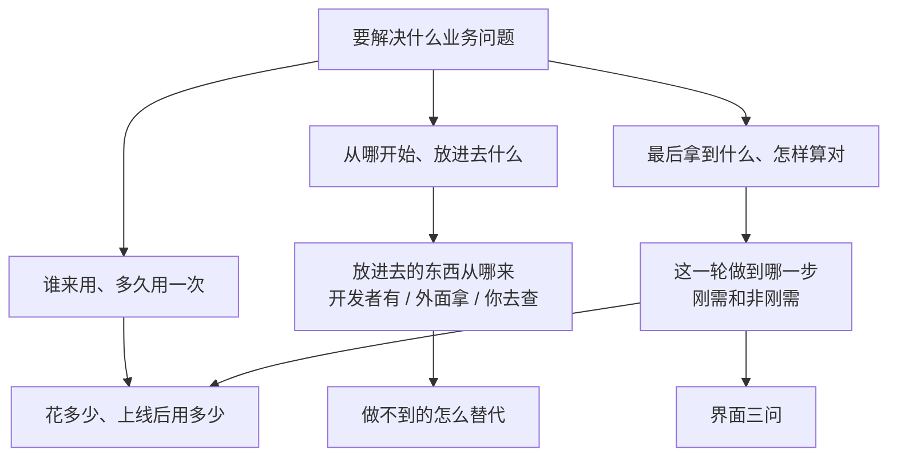
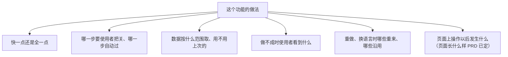

# 按轮问：从一句话问到能动笔

① 写 PRD 前、② 写方案前都这样问：① 问「要什么」，② 问「怎么取舍」。只问入口「开发者确认什么」里的四类事。做法：把要定的事排成一棵树，一轮一轮问；事实你自己查，决定交给开发者。每道题的写法见入口 [提问与交接.md](../../agenticapp-creator/references/提问与交接.md)（选择题、事实题）。各轮的样子见下面「一轮长什么样」。

① 第一轮要用的都在这一份：开始前的几种情况、读材料要记什么、怎么排树和一轮一轮问、每轮的样例。

## 开始前的几种情况

进 ① 时要问开发站点，或是从修订、讨论进来的，开始前看这一节。

- 要问开发站点时（什么时候问、答案怎么用见 `agenticapp-tool-workspace`「新建」）：站点题是事实题，只有开发者知道，不给推荐，编作 Q1，和第一轮的题一起发；初始化后，下一条消息前写好最小草案。
- 从修订进来的只确认这次要改的部分；只改文案、样式的不进这一段（`agenticapp-task-revise` 的改动起点表）。
- 从讨论进来的（「这个应用该怎么做」「先出个方案」），这一轮只做到 PRD；开发者明确说只在聊天里回答时照做。讨论不等于同意制作、部署或上线。

## 读材料要记什么

① 第 1 步读开发者给的材料、把写明的事记成「已定的事」时看这一节。

要记的有：谁来用、使用者做什么；判断点、交付物、要存的东西、提到的数量（一天几次、一次多少条）；一次记录代表的整体业务对象、每个入口实际做什么、什么时候只算提交或受理、实际产生什么结果（没有产物也记明，命名按 `agenticapp-tool-frontend`「业务文案」）；页面样子（截图、原型、参考应用、说过的页面）记进 G1 的界面答案，② 写进方案「功能与页面」。

## 从开发者给的东西开始

| 开发者给了 | 怎么做 |
|---|---|
| 需求文档、纪要、原型、截图、以前做过的成果 | 读完，写明的事直接记成「已定」，不再问；只问没写的、互相矛盾的，和写了「暂定」「或」「待定」这类没说死的 |
| 一段话，方向清楚（说得出谁来用、最后拿到什么） | 从下面的起步方向开始问 |
| 一段话，方向还不清楚（「想用 AI 做点小红书的事」） | 第一轮只问方向这一题，其他题都等方向定了再问。按你对这类业务的理解给 2–3 个做法，每个写清给谁用、放进去什么、拿出来什么；平台上还没查过的能力写成「打算……」，不写成已经能拿到 |

- **方向题**定的是整个应用：开发者只回「是」「你说呢」「都行」都不算定，要他说出选哪个，不替他选，方向定之前也不问别的题、不调制作工具；他说不清时下一轮换成更具体的 2–3 个做法，各举一个使用场景。他回的是组合或改动（「A 加上 B 的报告」），下一轮开头用一两句话复述你理解的方向，请他确认。
- 材料里需求方**点名要用的工具或平台**（「韩国用 Kakao 地图」）当作要求记成「已定」，你去真查；查不通、或几份材料说法矛盾时出选择题。没人点名的工具由你定，不问。
- **请开发者再给东西**只限你一定不知道的事：
  - 他提到手上有（「我们有一份 SOP」「表格在我这」），下一轮「要你做的」里请他给，说清用来做什么。
  - 真实样例（一家店、一个客户、一份单据）在方向定了、确实要真调或试跑时才要。他提过具体样例就要这个；没提过的，你从公开信息里挑贴近的直接用，不出题请他挑，在「刚做完」里说用了哪个、为什么，顺带说「你手上有现成的也可以换成你的」。
  - 业务数据是他的内部数据、没有公开来源时（门店订单、员工记录），按业务常识编几组测试数据（正常的和容易出错的各几组），在 PRD 和「我先跑了一遍」里标「测试数据，非真实」。这是测试样例，不算捏造结果。
  - 真调或试跑要花钱时，份数和积分照样先问（入口「花费」）。他说过没有的，不再要。
- **需求方和开发者不是同一人**：需求方的原话、文档、会议结论和开发者的话同等对待，冲突的出选择题。要别人答的题，题号后写「请需求方答」；材料里提需求的人和拍板的人不是同一个时，按材料的说法写「请业务负责人答」。开发者可以代答，在「要你做的」里说明。

## 把要定的事排成一棵树

每个要定的事是一个节点，它依赖的事挂在它上面。开发者每个回答都会定下一些节点，也会冒出新节点（答了「要先导入以前的记录」，就多出「以前的记录在哪、什么格式」）。树只给你排顺序，不发给开发者。下面是通常的起步方向，不是要逐项问完的清单：说过的跳过、无关的不问，实际依赖不同按实际排（「要不要每周自动出一份」取决于数据多久更新，就先问数据从哪来）。

① 问「要什么」：



② 问「怎么取舍」，每个刚需从这几个方向起步：



- 使用者看得到差别的事归 ①（报告按哪一周算、带不带配图建议）；使用者看到的一样、只是做法不同的归 ②。
- 每一步用哪一档模型由你定，不出题；只有换档会让花费超出上限、或明显改变结果时，才当作「快一点还是全一点」来问。

## 每个应用都要问的题

① 里除非开发者已经说过，下面几题都要问到，放在它们依赖的事定下之后那一轮；写 PRD 前核对都有答案（他答的，或按默认）。

| 题 | 为什么 | 怎么问 |
|---|---|---|
| 这一轮做到哪一步 | 定刚需和「这次不做的」 | 选择题 |
| 谁来用、多久用一次 | 决定页面怎么排、用词和日常费用 | 事实题，只定一种使用者（[谁来做.md](谁来做.md)「谁来用」）；材料点名了第二种人且他的动作是刚需时，按同一节出选择题 |
| 做这个应用最多花多少积分（开发和测试的上限，覆盖 ① 到 ⑤ 整张工单） | 每段按它控制花费 | 选择题，推荐值按真跑单价和预计份数算。说明要让第一次用的人看懂：写出 1 积分 = 0.01 元、每个选项约合多少元（不写「按平台计价额度折算」这类没有数字的话），选了不会先扣、只按实际运行扣，用到 80% 停下来问。开发者一开始就自己报了数字的不用再出题，但这几句在下一条交接里照样说 |
| 上线后一周大概用多少次、一次最多处理多少条（到点自动的应用次数已定，只问一次涉及多少条） | 用量决定日常费用和单次能不能跑完；一万条和十条的做法不一样 | 事实题 |
| 界面三问：有没有喜欢的参考（网站、截图、同类产品、「像 X 那样」）；打开应用第一眼要看到什么（数字、待办、最新结果、内容库……）；整体感觉（信息密集的工作台还是简洁大方，偏专业、活泼还是高端；有没有品牌色、Logo） | 定页面依据 | 开发者没说过页面长什么样时，三题同一轮一起发、不逐个追问；答了什么照抄进 G1，② 写进方案「功能与页面」；说「你看着办」「按常见做法」的记「按默认」，按 `agenticapp-tool-frontend`「界面风格」自定 |

## 问的时候就要想到的情况（只用于 ①）

问的时候就要想到这几种情况，写进对应的刚需：输入为空、不合法或超过用量上限，同一业务再做一次，外部数据拿不到或要授权，写进「会停下的情况」；记录之间会冲突的（预约撞期、库存超卖、重名），问清撞上时是拦下还是只提醒；要提醒或通知人的，问清发到哪，平台发不到的当轮说；模型判错或编造，写进「这样不行」（资料不够就写缺口，不编）；使用者第一次打开是空库时看到什么；业务特有的规则查 `agenticapp-ref-experience` 后问清。

开发者的业务可能同时有几条线（几个账号、几家店、几类业务、几个计划）时，不等他提，主动问清：合在一份里还是分开管；预算、内容、结果各归哪一条，几条线的预算有没有总上限；一条出了新结果，会不会盖掉另一条还在进行的。定下的写进需求文档。他没想过这件事，是因为他不知道这会影响数据怎么存；等到做完再改，要同时动数据、页面和生成范围。

## 一轮一轮问

- **每轮问「现在就能问」的全部问题**：它依赖的节点都已定。一题依赖这一轮另一题的答案时留到下一轮。发完一轮就等回答，按回答重排树，再算下一轮。
- **事实你自己查**：平台上有没有这个能力、真调拿回什么、试跑多久花多少，都边问边查，不拿来问开发者。查询不挡住整轮：只有依赖查询结果的题等结果出来再问，其余照常发。要他拍板的事每一件都问他、等他答。
- **题号接着编**：同一个应用从第一轮起连续编号，② 接着 ① 往下编；上一轮没答的沿用原题号。
- **问到树上没有空节点为止**。每轮交接消息的「下一步」写答完这一轮还剩哪几块要问、估计还要几轮；这一轮答完就问完的，写明不再出题，接着写 PRD。因回答冒出新题而多问的轮次同样写；说过不再出题又要问的，先说一句是哪个回答带出了新题。

## 什么算定了

- 开发者给了答案；或明确说「是」「按推荐」「你看着办」：按推荐定下，在 PRD（② 在方案）原处标「按默认」，他以后可以直接改。整条只回一个「是」或「都按推荐」，算这一轮有推荐的题全部按推荐，方向题和事实题除外。
- 花费上限题回「不限」「随便」「你看着办」：不算没有上限。按推荐值定成具体积分数，标「按默认」，下一条交接写明定的数、到 80% 会停下问他、这个数他随时能改。「不限」不是可以不收敛花费的理由，没有上限，到 80% 该停的时候就停不下来。
- 事实题（站点、账号、现在记在哪、业务规则，题目写着只有他知道的）回「你定」「你看着办」「都行」：不替他挑，下一轮只把这题再问一次，说清为什么只有他知道、不答会按什么做。第二次还是这样回，按下一条定下。
- 事实题回「不确定」：按对「要什么」影响最小的做法定下，标「按默认」，下一轮「刚做完」里说一句按什么定的。
- 说「别问了」「都你定」「全自动」：有推荐的题按推荐定下。方向题和事实题这些只有他知道的事没答的，不替他编：只留这几题再问一次，说明不答会按什么做、对结果有什么影响；还不答的按上一条定下。这句话也不算确认方案或同意上线。
- 没回的题不算定，不替他假设，下一轮接着问。
- 按默认的推荐项后来核实做不到（工具查不到、权限接不上）：改用其余选项里能做的、对「要什么」影响最小的一项，原处标「按默认，原推荐做不到：<原因>」，下一条交接消息「刚做完」里说一句。剩下的都做不到、或都会改变要什么时，重新出这道题，写清原推荐为什么做不到。

## 不重复问

- 每发一轮前对照「已定的事」：他原话说过的、材料写明的、之前答过的、标了「按默认」的，都不再问。
- 上一轮没回的题接着问，题目前标「上一轮没答」，这不算重复。
- 答案含糊时不把原题再发一遍：把含糊处拆成更具体的问题问一次，说明里写「你上一轮说……，具体是哪种」。
- 他后来改了主意，以最新的话为准，更新「已定的事」；依赖它的节点重新变空，下一轮再问。
- 「已定的事」写进当段阶段文档（① G1，② G3）：每条写定了什么、谁说的或按默认、哪一轮定的。

## 问完就写 PRD（只用于 ①）

树上没有空节点了，直接写 PRD 第 1 版，不另发一条清单请他回「对」：一个应用只确认三次，PRD 本身就是给他核对的那份。「按默认」定下的在 PRD 原处标出，他确认 PRD 时一眼看得到。② 同样只整理已定事项，不为复述已有答案再要确认。

Studio 宿主下一轮的题用 Studio 表单发，怎么写、答案怎么回来按 `agenticapp-host-studio`。

## 一轮长什么样

照上面发每一轮时对照。例子为了短，题目说明只写了一句。

### 第一轮

看完开发者给的东西马上发。这时平台上的查询多半还没出结果，「刚做完」写读了什么、正在查什么，结果放进下一轮。

```text
【① 需求确认 → 等你确认】
刚做完：读了你说的「想做一个小红书商家分析报告的应用」；正在平台上查小红书数据和地图工具，结果下一轮告诉你。
下一步：你答完这 4 题，我接着问报告要哪几部分、先做到哪一步，估计再问 2 轮。
要你做的：答下面 4 题，按编号回；同意推荐的回「是」。
花了多少：这一阶段 0 积分；一共 0；上限等你在第 4 题定。

❓ Q1 谁来用：这个应用给谁用？他们平时做什么、多久会用一次？（这题只有你知道，没有推荐答案，照实说就行）

❓ Q2 从哪开始：（照入口 `../../agenticapp-creator/references/提问与交接.md`「选择题」里的样例题）

❓ Q3 拿到什么：使用者最后拿到什么？
   A 一份商家报告，加上能直接发的小红书内容
   B 只要报告
   C 其他，说说你的想法
➡️ 推荐 A，报告加小红书内容

❓ Q4 花费上限：做这个应用，从现在到上线（① 到 ⑤），制作和测试最多花多少积分？1 积分 = 0.01 元；这里定的是上限，选了不会先扣，只在试跑时按实际用量扣，用到 80% 我会停下来问你。每试跑一份完整报告约 760 积分。
   A 15,000 积分（约 150 元）：够真查 5 家店、每家试跑一份报告；用到 12,000 时我停下来问你
   B 8,000 积分（约 80 元）：只试跑 2 家，报告质量看得少一些
   C 其他，给一个具体数字
➡️ 推荐 A，15,000 积分
```

### 要花钱的试跑先出同意题

方向定了、要真调或试跑时，样例你自己挑：

```text
❓ Q5 先试跑一份：用公开信息里的「莫定标娘惹糕点（槟城）」真查一次并试跑一份完整报告，约 760 积分，看资料少的店报告够不够写。
   A 同意，跑一份
   B 先不跑，PRD 里的效果和花费按估算写
   C 其他，说说你的想法
➡️ 推荐 A
```
