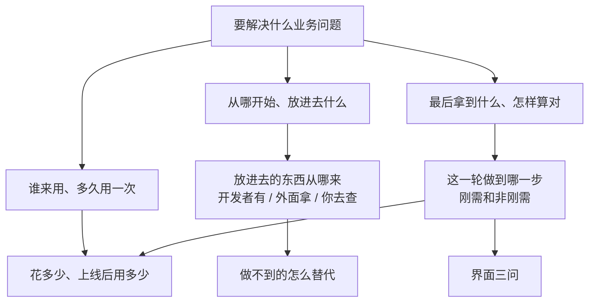
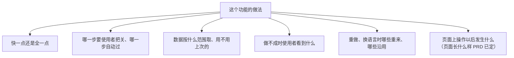

# 按轮问：从一句话问到能动笔

① 写 PRD 前、② 写方案前，都用这种问法和开发者把事情问清楚，直到双方理解一致。① 问「要什么」，② 问「怎么取舍」。只问 [../SKILL.md](../SKILL.md)「开发者确认什么」里的四类事。问法参照 grill-me：把要定的事排成一棵树，一轮一轮问，事实你自己查，决定交给开发者。每道题怎么写见 [选择题与判断题.md](选择题与判断题.md)。

## 从开发者给的东西开始

开发者给什么都可以开始，一句话也够。先看手上有什么：

| 开发者给了 | 怎么做 |
|---|---|
| 需求文档、纪要、原型、截图、以前做过的成果 | 读完，把里面已经写明的事直接记成「已定」，不再问；只问没写的、互相矛盾的，和写了「暂定」「或」「待定」这类没说死的 |
| 一段话，方向清楚（说得出谁来用、最后拿到什么） | 直接从下面的起步方向开始问 |
| 一段话，方向还不清楚（「想用 AI 做点小红书的事」） | 第一轮只问方向这一题，其他题都依赖方向，等方向定了再问。按你对这类业务的理解给 2–3 个可能的做法，每个写清给谁用、放进去什么、拿出来什么；平台上还没查过的能力写成「打算……」，不写成已经能拿到 |

方向题定的是整个应用，开发者只回「是」不算定，要请开发者说出选哪个；开发者回的是组合或改动（「A 加上 B 的报告」），在下一轮开头用一两句话复述你理解的方向，请他确认。

材料里需求方点名要用的工具或平台（「韩国用 Kakao 地图」），当作要求记成「已定」，你去真查；查不通、或几份材料说法互相矛盾时出选择题。没人点名的工具由你定，不问。

要不要请开发者再给东西，看开发者的话判断，只在你一定不知道的事上请他输入：

- 开发者提到手上有东西（「我们有一份 SOP」「上次给客户做过一份」「表格在我这」），在下一轮的「要你做的」里请他给，说清用来做什么。
- 真实样例（一家店、一个客户、一份单据）在方向定了、确实要真调或试跑时才要。开发者话里提到过具体的样例，请他给这个；没提过的，你从公开信息里挑贴近的直接用，不出题请他确认挑哪个，在「刚做完」里说一句用了哪个、为什么挑它，顺带说「你手上有现成的也可以换成你的」。真调或试跑要花钱时，份数和积分照样先问（[../SKILL.md](../SKILL.md)「花费」）。
- 开发者已经说过没有的，不再要。

## 把要定的事排成一棵树

每个要定的事是树上的一个节点，它依赖的事挂在它上面。树从对话里长出来：开发者的每个回答都会定下一些节点，也会冒出新的节点（例如答了「要先导入以前的记录」，就多出「以前的记录在哪、什么格式」）。树是你自己用来排顺序的，不发给开发者。

下面是起步时通常先问的方向，不是要逐项问完的清单；开发者已经说过的跳过，和这个应用无关的不问。图里的先后是常见的依赖，这个应用实际的依赖不一样时按实际排（例如「要不要每周自动出一份」取决于数据多久更新一次，就先问数据从哪来）。

① 问「要什么」：



使用者看得到差别的事归 ①（例如报告按哪一周算、带不带配图建议）；使用者看到的一样、只是做法不同的归 ②。

② 问「怎么取舍」，每个刚需从这几个方向起步：



每一步用哪一档模型由你定，不出取舍题（[谁来做.md](谁来做.md)「模型选哪一档」）；只有换档会让花费超出上限、或明显改变结果时，才当作「快一点还是全一点」的取舍问。

## 每个应用都要问的题

除非开发者已经说过，① 里必须问到下面几题，放在它们依赖的事定下之后的那一轮；发「我理解的是这些」之前核对这几题都有答案（开发者答的，或按默认）。

| 题 | 为什么 | 怎么问 |
|---|---|---|
| 这一轮做到哪一步 | 定刚需和「这次不做的」 | 选择题 |
| 谁来用、多久用一次 | 决定页面怎么排、用词和日常费用 | 事实题（只有开发者知道），按 [谁来做.md](谁来做.md)「谁来用」只定一种使用者 |
| 做这个应用最多花多少积分（开发和测试的上限，覆盖 ① 到 ⑤ 整张工单） | 每段按它控制花费 | 选择题，推荐值按真跑单价和预计份数算 |
| 上线后一周大概用多少次、一次最多处理多少条（到点自动的应用，次数已定，问一次涉及多少条） | 用量决定日常费用和单次能不能跑完；一万条数据和十条数据的做法不一样 | 事实题 |
| 界面三问：有没有喜欢的参考（网站链接、截图、同类产品，或「像 X 那样」）；使用者打开应用第一眼要看到什么（数字、待办、最新结果、内容库……）；整体感觉（信息密集的工作台还是简洁大方，偏专业、活泼还是高端；有没有品牌色、Logo） | 定页面依据 | 开发者没说过页面长什么样时，三题在同一轮一起发、不逐个追问；开发者答了什么照抄进 PRD「界面」；说「你看着办」「按常见做法」的，按 [../reference/前端页面.md](../reference/前端页面.md)「界面风格」自定，PRD 记「按默认」 |

## 一轮一轮问

- **每轮问「现在就能问」的全部问题**：它依赖的节点都已经定了。一题的答案依赖这一轮另一道题时，留到下一轮。发完一轮就等开发者回答，按回答重新排树，再算下一轮能问什么。Studio 里一张表单装不下时怎么发，见 [../reference/Studio表单与卡片.md](../reference/Studio表单与卡片.md)「按轮问怎么写成表单」。
- **每题带推荐答案**，开发者回「是」就是采纳推荐；只有开发者知道的事实题不给选项和推荐，写法见 [选择题与判断题.md](选择题与判断题.md)「事实题」。
- **事实你自己查，决定交给开发者**：平台上有没有这个能力、真调拿回什么、试跑要多久花多少，都是你边问边查（① 按 [../stages/1-需求确认.md](../stages/1-需求确认.md)「2.3 同时核实」，② 按 [../stages/2-方案.md](../stages/2-方案.md)「2.1 问取舍」），不拿来问开发者。查询不挡住整轮：只有依赖查询结果的那几题等结果出来再问，其余照常发。要开发者拍板的事，每一件都问他，等他答。
- **题号接着编**：同一个应用从第一轮起连续编号，② 接着 ① 的题号往下编，不从 Q1 重来；上一轮没答的题沿用原题号。
- **问到树上没有空着的节点为止，不限轮数**。

### 什么算定了

- 开发者给了答案；或明确说「是」「按推荐」「你看着办」，这时按推荐定下，在 PRD（② 在方案）原处标「按默认」，开发者以后可以直接改。整条只回一个「是」或「都按推荐」，算这一轮有推荐的题全部按推荐，方向题和事实题除外。
- 事实题回「不确定」：按对「要什么」影响最小的做法定下，标「按默认」，在下一轮「刚做完」里说一句按什么定的。
- 开发者没回的题不算定，不替他假设，下一轮接着问。
- 按默认的推荐项后来核实做不到（推荐的工具查不到、权限接不上）：改用其余选项里能做的、对「要什么」影响最小的一项，原处标「按默认，原推荐做不到：<原因>」，下一条交接消息的「刚做完」里说一句。剩下的选项都做不到、或都会改变要什么时，重新出这道题，写清原推荐为什么做不到。

## 不重复问

- 每发一轮之前，对照「已定的事」：开发者原话说过的、材料里写明的、之前轮答过的、标了「按默认」的，都不再问。
- 上一轮没回的题，下一轮接着问，题目前标「上一轮没答」；这不算重复问。
- 开发者的答案含糊时，不把原题再发一遍；把含糊的地方拆成更具体的问题问一次，说明里写「你上一轮说……，具体是哪种」。
- 开发者后来改了主意，以最新的话为准，更新「已定的事」，依赖它的节点重新变成空的，下一轮再问。
- 「已定的事」写进当段的阶段文档（① 写 G1，② 写 G3）：每条写定了什么、谁说的或按默认、哪一轮定的。

## 先确认理解，再动笔

树上没有空着的节点了，先不动笔，发一条「我理解的是这些」：

- 按树的顺序列出所有已定的事，每条一句业务话；标「按默认」的单独标出来；
- 结尾问「我理解得对吗？对的话我开始写 PRD（② 写方案）；哪条不对直接说」。

开发者回「对」再动笔：① 写 PRD，② 写施工单和业务说明。开发者指出哪条不对，改那条并重新排树，冒出新的空节点就再问一轮，然后再确认一次。

这样写出来的 PRD 和方案只是把双方已经确认的东西整理成一页，开发者确认时只需要看有没有写错。

## 一轮长什么样

第一轮在看完开发者给的东西后马上发，这时平台上的查询多半还没出结果，「刚做完」写读了什么、正在查什么，结果放进下一轮（下面的例子为了短，说明只写了一句）：

```text
【① 需求确认 → 等你确认】
刚做完：读了你说的「想做一个小红书商家分析报告的应用」；正在平台上查小红书数据和地图工具，结果下一轮告诉你。
下一步：你答完这 4 题，我接着问报告要哪几部分、先做到哪一步。
要你做的：答下面 4 题，按编号回；同意推荐的回「是」。
花了多少：本段 0 积分；累计 0；上限等你在第 4 题定。

❓ Q1 谁来用：这个应用给谁用？他们平时做什么、多久会用一次？（这题只有你知道，没有推荐答案，照实说就行）

❓ Q2 从哪开始：使用者要先填什么才能开始？
   A 只填店名，城市选填：门店由应用去查，查到几家时让使用者选
   B 店名、城市、官网、小红书主页都填：查得更准，但使用者要先准备好这些
   C 其他，说说你的想法
➡️ 推荐 A，只填店名

❓ Q3 拿到什么：使用者最后拿到什么？
   A 一份商家报告，加上能直接发的小红书内容
   B 只要报告
   C 其他，说说你的想法
➡️ 推荐 A，报告加小红书内容

❓ Q4 花费上限：做这个应用，从现在到上线（① 到 ⑤），制作和测试最多花多少积分？每试跑一份完整报告约 760 积分。
   A 15,000 积分：够真查 5 家店、每家试跑一份报告；用到 12,000 时我停下来问你
   B 8,000 积分：只试跑 2 家，报告质量看得少一些
   C 其他，给一个具体数字
➡️ 推荐 A，15,000 积分
```

方向定了、要真调或试跑时，样例你自己挑，花钱的先出一道同意题：

```text
❓ Q5 先试跑一份：用公开信息里的「莫定标娘惹糕点（槟城）」真查一次并试跑一份完整报告，约 760 积分，看资料少的店报告够不够写。
   A 同意，跑一份
   B 先不跑，PRD 里的效果和花费按估算写
   C 其他，说说你的想法
➡️ 推荐 A
```

确认理解的那一条长这样：

```text
【① 需求确认 → 等你确认】
刚做完：你在 Q5 同意后，用「莫定标娘惹糕点（槟城）」真查并试跑了一份报告（老字号、小红书笔记不多），拿回来的东西够写报告；你手上有现成的店也可以换成你的。问完了，下面是我理解的你要的东西。
下一步：你回「对」后我写 PRD 第 1 版。
要你做的：看下面 9 条，对的话回「对」；哪条不对直接说是第几条。
花了多少：本段 760 积分（Q5 同意的试跑一份）；累计 760；上限 15,000。

1. 使用者是公司内部做商家建联、做视频的人，每人每周做几份。
2. 使用者只填店名，城市选填；查到几家门店时让使用者选。
……
8. 这一轮先不做新人演示。（你回了「你看着办」，按默认）
9. 海外门店用网页搜索代替地图。
我理解得对吗？
```

## 在 Studio 里怎么发

宿主有 Studio 制作工具（工具列表里有 `studio_*`）时，一轮的题用 Studio 表单发，怎么写成表单、答案怎么回来、PRD 和方案的确认怎么做，见 [../reference/Studio表单与卡片.md](../reference/Studio表单与卡片.md)「按轮问怎么写成表单」。没有这些工具时照上面的文字格式发。
